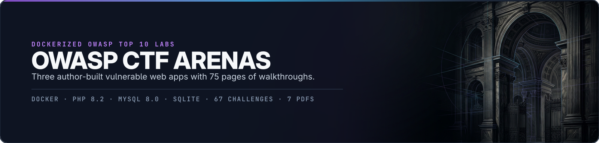
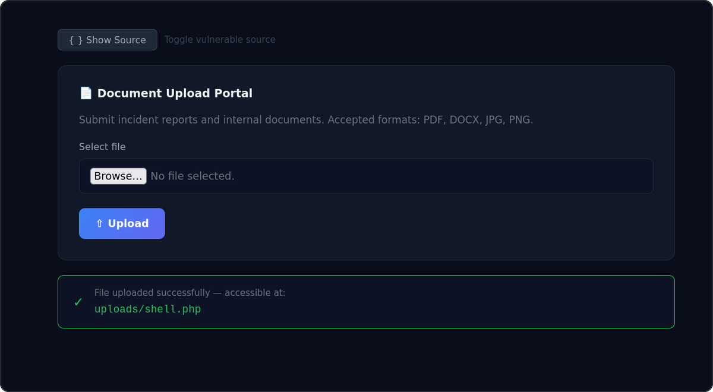
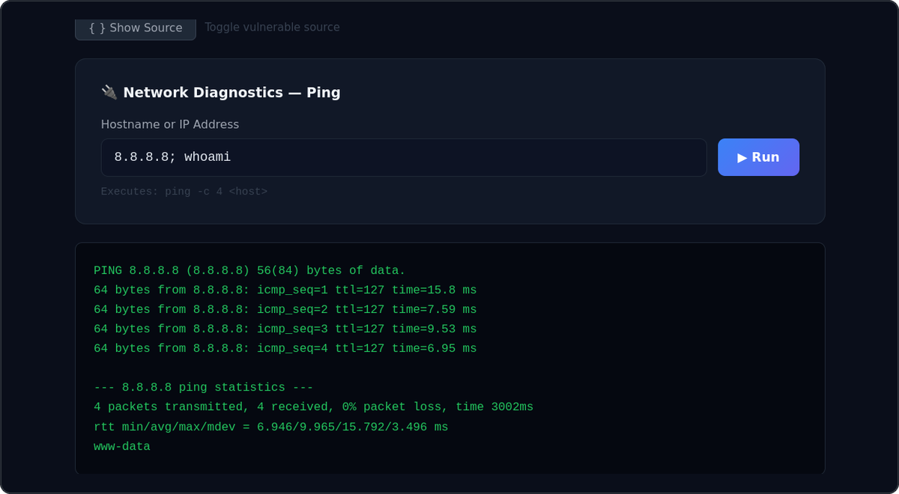
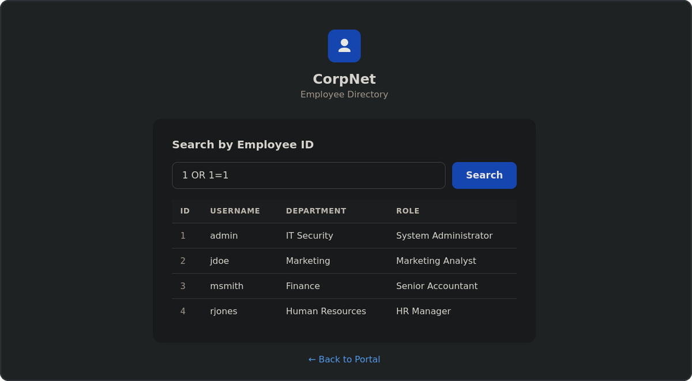
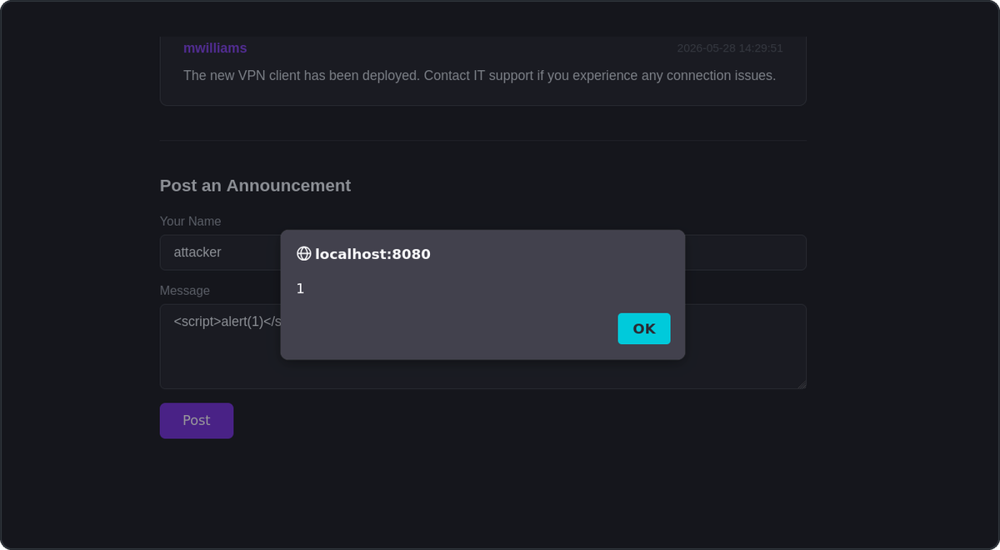

<div align="center">



<br/>

<p>
  <a href="#arenas"></a>
  <a href="#walkthroughs"></a>
  <a href="https://owasp.org/www-project-top-ten/"></a>
  <a href="LICENSE"></a>
</p>

<p>
  <a href="#arenas">Arenas</a> ·
  <a href="#live-previews">Live Previews</a> ·
  <a href="#walkthroughs">Walkthroughs</a> ·
  <a href="#quick-start">Quick Start</a> ·
  <a href="SECURITY.md">Security Policy</a>
</p>

</div>

<br/>

**OWASP CTF Arenas** is a collection of three intentionally vulnerable web applications built from scratch in Docker for the Cyberium "Hack The Grid" CTF tournament. Each arena ships as a self-contained local deployment (`PHP 8.2`, `MySQL 8.0`, `SQLite`) paired with step-by-step author walkthrough PDFs covering **67 challenge questions** across **75 pages**.

> **Lab Safety:** All three arenas contain deliberate application-layer flaws for isolated local training. Archives are password-protected (`infected`) to prevent accidental host deployment or AV quarantine; never expose container ports to untrusted networks.

## Arenas

| Arena | Runtime Stack | Vulnerability Classes | Questions | Package &amp; Docs |
| :--- | :--- | :--- | :---: | :--- |
| [**CorpLink PHP**](corplink-php/README.md) | `php:8.2-apache` (Docker) | Unrestricted File Upload (RCE), OS Command Injection, Local File Inclusion, Unsigned Cookie PrivEsc | 37 | [`htg-php.zip`](corplink-php/htg-php.zip) · [4 PDFs (41p)](corplink-php/README.md#walkthroughs) |
| [**CorpNet SQLi**](corpnet-sqli/README.md) | `php:8.2-apache` + `mysql:8.0` | Auth Bypass (`OR 1=1`), `ORDER BY` / `UNION SELECT`, `information_schema` Dumping | 10 | [`htg-sqli.zip`](corpnet-sqli/htg-sqli.zip) · [1 PDF (11p)](corpnet-sqli/README.md#walkthrough) |
| [**BrightBoard XSS**](brightboard-xss/README.md) | `php:8.2-apache` + SQLite PDO + JS | Reflected XSS, Stored XSS, DOM `innerHTML` Sinks, Non-`HttpOnly` Cookie Hijacking | 20 | [`htg-xss.zip`](brightboard-xss/htg-xss.zip) · [2 PDFs (23p)](brightboard-xss/README.md#walkthroughs) |

## Live Previews

Captured live against the running Docker containers during exploitation verification:

<table>
  <tr>
    <td width="50%" align="center">
      <a href="assets/screenshots/corplink-upload.png"></a><br/>
      <sub><b>CorpLink PHP (C1)</b> — Unrestricted upload accepting <code>uploads/shell.php</code></sub>
    </td>
    <td width="50%" align="center">
      <a href="assets/screenshots/corplink-cmdi.png"></a><br/>
      <sub><b>CorpLink PHP (C2)</b> — Ping diagnostics command injection (<code>8.8.8.8; whoami</code>)</sub>
    </td>
  </tr>
  <tr>
    <td width="50%" align="center">
      <a href="assets/screenshots/corpnet-sqli.png"></a><br/>
      <sub><b>CorpNet SQLi</b> — Directory filter bypass (<code>1 OR 1=1</code>) dumping all accounts</sub>
    </td>
    <td width="50%" align="center">
      <a href="assets/screenshots/brightboard-xss.png"></a><br/>
      <sub><b>BrightBoard XSS</b> — Persistent announcement board executing injected script</sub>
    </td>
  </tr>
</table>

## Walkthroughs

Every challenge includes an illustrated walkthrough detailing reconnaissance, vulnerable source analysis, exploitation payloads, and remediation:

| Arena | Walkthrough PDF | Scope | Questions | Length |
| :--- | :--- | :--- | :---: | :---: |
| **CorpLink PHP** | [`c1-file-upload.pdf`](corplink-php/walkthroughs/c1-file-upload.pdf) | MIME bypass &amp; PHP webshell upload RCE | 10 | 11p · 1.1 MB |
| **CorpLink PHP** | [`c2-command-injection.pdf`](corplink-php/walkthroughs/c2-command-injection.pdf) | Shell metacharacter injection via ping utility | 10 | 11p · 1.0 MB |
| **CorpLink PHP** | [`c3-lfi.pdf`](corplink-php/walkthroughs/c3-lfi.pdf) | Dynamic `include()` traversal to `/etc/passwd` | 9 | 10p · 866 KB |
| **CorpLink PHP** | [`c4-cookie.pdf`](corplink-php/walkthroughs/c4-cookie.pdf) | Client-side role cookie tampering to admin | 8 | 9p · 742 KB |
| **CorpNet SQLi** | [`corpnet-sqli-walkthrough.pdf`](corpnet-sqli/walkthroughs/corpnet-sqli-walkthrough.pdf) | Auth bypass, `UNION SELECT` &amp; schema dump | 10 | 11p · 621 KB |
| **BrightBoard XSS** | [`BrightBoard-XSS-Walkthrough.pdf`](brightboard-xss/walkthroughs/BrightBoard-XSS-Walkthrough.pdf) | Reflected, Stored, DOM XSS &amp; session theft | 10 | 12p · 580 KB |
| **BrightBoard XSS** | [`c1-reflected-xss.pdf`](brightboard-xss/walkthroughs/c1-reflected-xss.pdf) | Reflected search context break &amp; JS execution | 10 | 11p · 887 KB |

## Quick Start

Requires Docker (with Compose plugin for CorpNet and BrightBoard) and `unzip`. Run one arena at a time — all three bind to local port `8080`. Archive password: `infected`.

```bash
git clone https://github.com/ArtistS24/owasp-ctf-arenas.git
cd owasp-ctf-arenas

# CorpLink PHP (4 challenges: upload, cmdi, LFI, cookie privesc)
cd corplink-php && unzip -P infected htg-php.zip && cd htg-php && bash start.sh

# CorpNet SQLi (PHP 8.2 + MySQL 8.0 via Docker Compose)
cd corpnet-sqli && unzip -P infected htg-sqli.zip && cd htg-sqli-final && bash start.sh

# BrightBoard XSS (PHP 8.2 + SQLite PDO via Docker Compose)
cd brightboard-xss && unzip -P infected htg-xss.zip && cd htg-xss-final && bash start.sh
```

Open `http://localhost:8080` in your browser once `start.sh` completes.

<details>
<summary>Teardown commands</summary>

```bash
# Run from inside the extracted arena directory (htg-php/, htg-sqli-final/, or htg-xss-final/)
bash stop.sh

# Note: corpnet-sqli's stop.sh prompts interactively: [1] Pause or [2] Full wipe
```

</details>

<details>
<summary>Repository layout</summary>

```text
owasp-ctf-arenas/
├── corplink-php/
│   ├── README.md
│   ├── htg-php.zip                           # Dockerized PHP 8.2 + Apache arena
│   └── walkthroughs/                         # 4 PDFs (41 pages, 37 questions)
├── corpnet-sqli/
│   ├── README.md
│   ├── htg-sqli.zip                          # Docker Compose PHP 8.2 + MySQL 8.0 arena
│   └── walkthroughs/                         # 1 PDF (11 pages, 10 questions)
├── brightboard-xss/
│   ├── README.md
│   ├── htg-xss.zip                           # Docker Compose PHP 8.2 + SQLite PDO arena
│   └── walkthroughs/                         # 2 PDFs (23 pages, 20 questions)
├── assets/
│   ├── header.png                            # Repository banner
│   ├── social_preview.{svg,png}              # OpenGraph preview card
│   └── screenshots/                          # Live captures from the running arenas
├── SECURITY.md
└── LICENSE
```

</details>

<br/>

<p align="center">
  <sub>MIT License · Built by <a href="https://github.com/ArtistS24">Denis Albin</a></sub>
</p>
